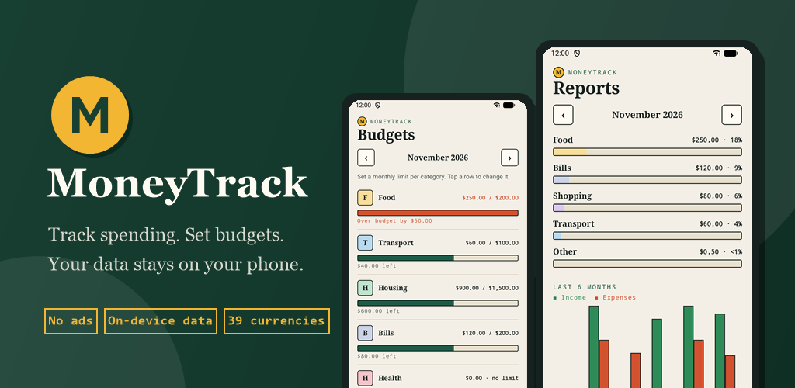
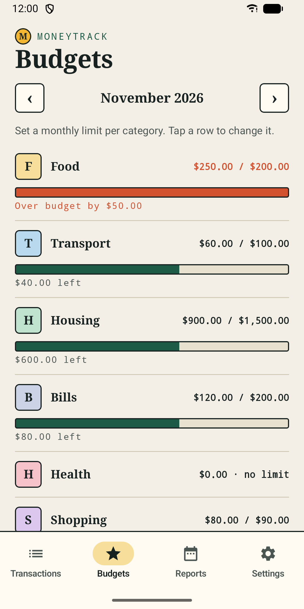

<p align="center">
  
</p>

# MoneyTrack

[](https://github.com/IOREBIYI/money-track/releases/latest)
[](LICENSE)


A simple, private personal finance tracker for Android. Built with Kotlin, Jetpack Compose and Room.

## Download
<!-- When the Play listing is live, replace the "in review" line with:
     Get it on Google Play: https://play.google.com/store/apps/details?id=com.moneytrack.app -->
- **Google Play:** in review, link coming soon.
- **APK:** download the latest signed build from [Releases](https://github.com/IOREBIYI/money-track/releases/latest). Check the SHA-256 in the release notes. If you later install from Play, uninstall the APK first (the two are signed with different keys), and export a CSV backup before you do.

Want to help test? Open an issue or email orebiyimayowa3@gmail.com.

<p>
  
  
  
  
  
</p>

## Features
- Track income and expenses with category, date and note
- Choose your currency from 39 options (display only, no conversion)
- A ledger-style design with its own palette and a matching dark mode
- Monthly budgets per category with progress bars
- Reports: spending by category and a 6-month income vs. expenses chart
- CSV export and restore (backup / move to a new phone)
- Sign up, sign in and "forgot password" by email (Firebase Authentication), with in-app account deletion
- Your transactions and budgets stay on your device and are never uploaded. No ads, no analytics. See [PRIVACY.md](PRIVACY.md)

## Tech stack
| Area | Technology |
|---|---|
| Language | Kotlin (JVM target 17) |
| UI | Jetpack Compose, Material 3 (Compose BOM 2025.10.00), Material icons |
| Architecture | MVVM: `ViewModel` + Kotlin coroutines / Flow, lifecycle-aware state collection |
| Local storage | Room 2.7.2 (SQLite), code generation with KSP |
| Authentication | Firebase Authentication, email and password (Firebase BOM 33.7.0) |
| Build | Gradle (Kotlin DSL), Android Gradle Plugin 8.11, Google Services plugin |
| Release | R8 minification and resource shrinking, signed upload key, Play App Signing |
| Testing | JUnit 4 unit tests (CSV, currencies, auth validation and error mapping, percent labels) |
| Platform | Android 8.0+ (minSdk 26), compile and target SDK 36 |
| Package / version | `com.moneytrack.app`, version 1.3.1 (versionCode 7) |

## Project structure
```
app/src/main/java/com/moneytrack/app/
  MainActivity.kt, MoneyApp.kt   App entry point and application class
  MoneyViewModel.kt              Transactions, budgets, reports and settings state
  auth/                          AuthRepository (Firebase), AuthViewModel, models and validation
  data/                          Room database and DAO, CSV import/export, currency list
  ui/                            Compose screens (AppRoot, Auth, Transactions, Budgets,
                                 Reports, Settings) and the Theme
app/src/test/                    Unit tests
store/                           Play icon, feature graphic, screenshots, listing answers
PRIVACY.md, ACCOUNT_DELETION.md  Policy pages required by Google Play
```

## Privacy and data
- Transactions and budgets live only in the on-device Room database and are never uploaded.
- Only your email address and user ID go to Firebase Authentication, for account management. Nothing is shared, and accounts can be deleted in the app.
- No ads, no analytics, no third-party trackers.
- Backups are plain CSV files you export and restore yourself.

## Build
Requires Android Studio (or JDK 17+ and the Android SDK 36).

```
./gradlew assembleDebug      # debug APK -> app/build/outputs/apk/debug
./gradlew bundleRelease      # Play Store bundle (.aab), needs app/google-services.json
./gradlew testDebugUnitTest  # unit tests
```

## Accounts setup (Firebase)
Sign in uses [Firebase Authentication](https://firebase.google.com/docs/auth). The repo does **not** include a Firebase project, so set up your own:

1. Create a project at [console.firebase.google.com](https://console.firebase.google.com) (Google Analytics is not needed).
2. **Build → Authentication → Get started → Sign-in method → Email/Password → Enable.**
3. **Project settings → Add app → Android**, package name `com.moneytrack.app`. (A SHA-1 is not required for email and password sign-in.)
4. Download `google-services.json` into `app/`. It is git-ignored.
5. Optional: customize the password-reset email under **Authentication → Templates**, and restrict the API key to your app in Google Cloud Console.

Debug builds without `google-services.json` still run and show "Accounts aren't set up in this build". **Release builds refuse to build without it**, so you can't ship a broken sign-in screen.

### Testing accounts without a Firebase project
Use the local [Firebase Auth emulator](https://firebase.google.com/docs/emulator-suite):

```
npx firebase-tools emulators:start --only auth --project demo-moneytrack
./gradlew assembleDebug -PauthEmulator=true
```

The debug app then talks to the emulator at `10.0.2.2:9099`. Password-reset links are printed in the emulator's log instead of being emailed.

### Release signing
Create `keystore.properties` in the project root (git-ignored):

```
storeFile=keystore/upload.jks
storePassword=...
keyAlias=upload
keyPassword=...
```
Without it, the release build is unsigned. **Never commit your keystore or passwords.**

## Releasing to Google Play
Store assets live in [`store/`](store): the 512×512 icon, the 1024×500 feature graphic, and phone screenshots (1080×2160).

1. **Bump the version** in `app/build.gradle.kts`. `versionCode` must be higher than the last upload; `versionName` is the user-facing version.
   ```kotlin
   versionCode = 2
   versionName = "1.0.1"
   ```
2. **Build the signed bundle** (requires `keystore.properties`, see above):
   ```
   ./gradlew bundleRelease
   ```
   Output: `app/build/outputs/bundle/release/app-release.aab`
3. **Upload** it in the [Play Console](https://play.google.com/console) under *Test and release*: first to a closed or internal track, then promote to production.
4. **Add release notes**, then *Send changes for review*.
5. **Tag the release** so the source matches what shipped:
   ```
   git tag v1.0.1 && git push origin v1.0.1
   ```

### Listing details
| Field | Value |
|---|---|
| Package name | `com.moneytrack.app` |
| Category | Finance |
| Content rating | Everyone |
| Data safety | Email address and user ID collected for account management; not shared; encrypted in transit; deletion supported. See [store/play-data-safety.md](store/play-data-safety.md) |
| Privacy policy | https://moneytrack-wheat-nine.vercel.app/privacy (source: [PRIVACY.md](PRIVACY.md)) |
| Account deletion URL | https://moneytrack-wheat-nine.vercel.app/account-deletion (source: [ACCOUNT_DELETION.md](ACCOUNT_DELETION.md)) |
| Min / target SDK | 26 (Android 8.0) / 36 |

> The upload keystore (`keystore/upload.jks`) and its passwords are **not** in this repo. Keep a private backup: with Play App Signing a lost upload key can only be reset through Play support.

## License
MIT
