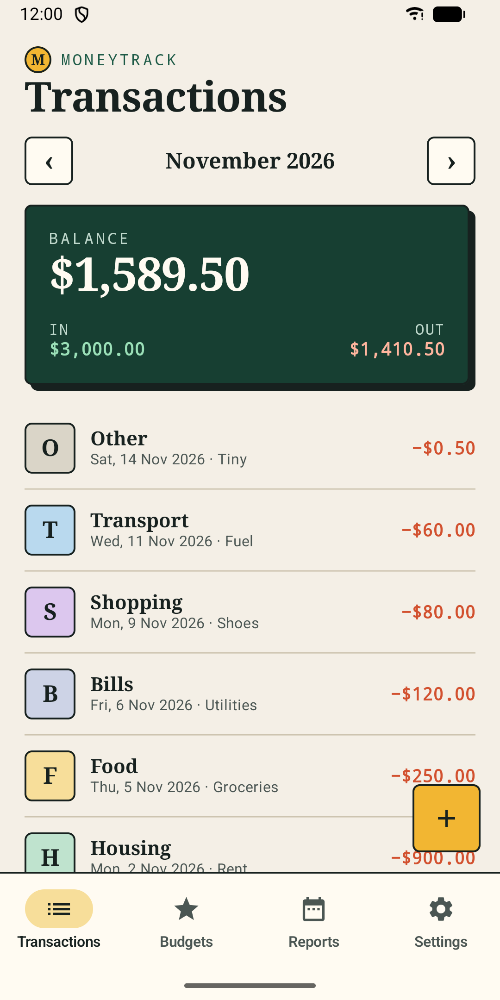
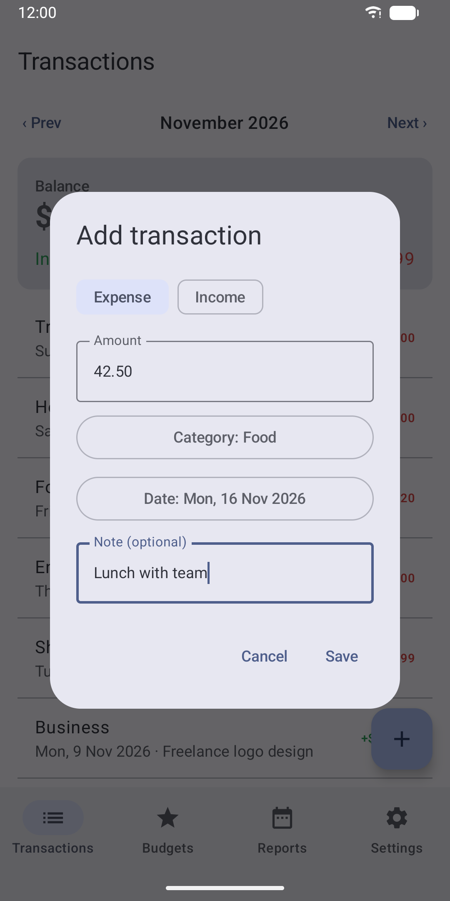
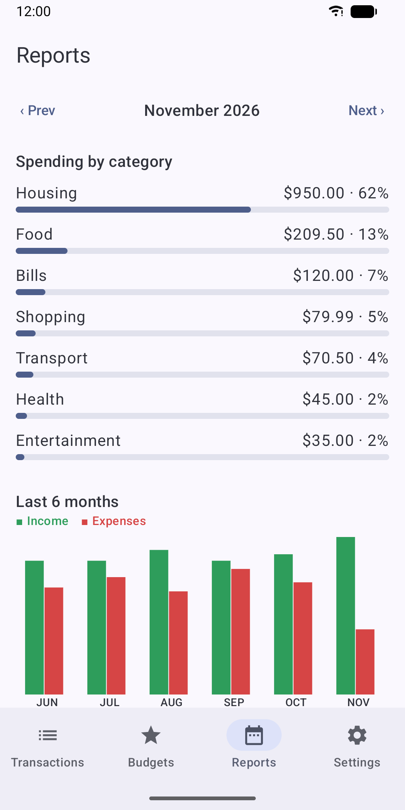
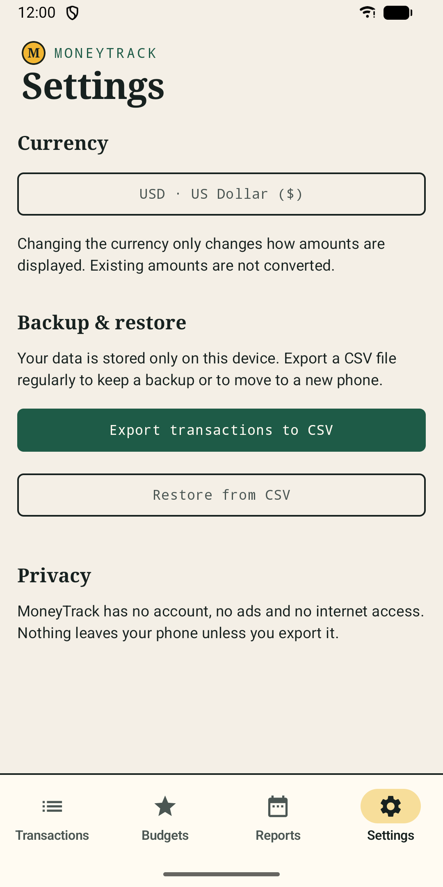

<p align="center">
  
</p>

# MoneyTrack

[](https://github.com/IOREBIYI/money-track/releases/latest)
[](LICENSE)


A simple, private personal finance tracker for Android. Built with Kotlin, Jetpack Compose and Room.

## Download
<!-- When the Play listing is live, replace the "in review" line with:
     Get it on Google Play: https://play.google.com/store/apps/details?id=com.moneytrack.app -->
- **Google Play:** in review, link coming soon.
- **APK:** download the latest signed build from [Releases](https://github.com/IOREBIYI/money-track/releases/latest). Check the SHA-256 in the release notes. If you later install from Play, uninstall the APK first (the two are signed with different keys), and export a CSV backup before you do.

Want to help test? Open an issue or email orebiyimayowa3@gmail.com.

<p>
  
  
  
  
  
</p>

## Features
- Track income and expenses with category, date and note
- Choose your currency from 39 options (display only, no conversion)
- A ledger-style design with its own palette and a matching dark mode
- Monthly budgets per category with progress bars
- Reports: spending by category and a 6-month income vs. expenses chart
- CSV export and restore (backup / move to a new phone)
- 100% offline: no account, no ads, no network permission. See [PRIVACY.md](PRIVACY.md)

## Build
Requires Android Studio (or JDK 17+ and the Android SDK 36).

```
./gradlew assembleDebug      # debug APK -> app/build/outputs/apk/debug
./gradlew bundleRelease      # Play Store bundle (.aab)
```

### Release signing
Create `keystore.properties` in the project root (git-ignored):

```
storeFile=keystore/upload.jks
storePassword=...
keyAlias=upload
keyPassword=...
```
Without it, the release build is unsigned. **Never commit your keystore or passwords.**

## Releasing to Google Play
Store assets live in [`store/`](store): the 512×512 icon, the 1024×500 feature graphic, and phone screenshots (1080×2160).

1. **Bump the version** in `app/build.gradle.kts`. `versionCode` must be higher than the last upload; `versionName` is the user-facing version.
   ```kotlin
   versionCode = 2
   versionName = "1.0.1"
   ```
2. **Build the signed bundle** (requires `keystore.properties`, see above):
   ```
   ./gradlew bundleRelease
   ```
   Output: `app/build/outputs/bundle/release/app-release.aab`
3. **Upload** it in the [Play Console](https://play.google.com/console) under *Test and release*: first to a closed or internal track, then promote to production.
4. **Add release notes**, then *Send changes for review*.
5. **Tag the release** so the source matches what shipped:
   ```
   git tag v1.0.1 && git push origin v1.0.1
   ```

### Listing details
| Field | Value |
|---|---|
| Package name | `com.moneytrack.app` |
| Category | Finance |
| Content rating | Everyone |
| Data safety | No data collected or shared |
| Privacy policy | [PRIVACY.md](PRIVACY.md) |
| Min / target SDK | 26 (Android 8.0) / 36 |

> The upload keystore (`keystore/upload.jks`) and its passwords are **not** in this repo. Keep a private backup: with Play App Signing a lost upload key can only be reset through Play support.

## License
MIT
