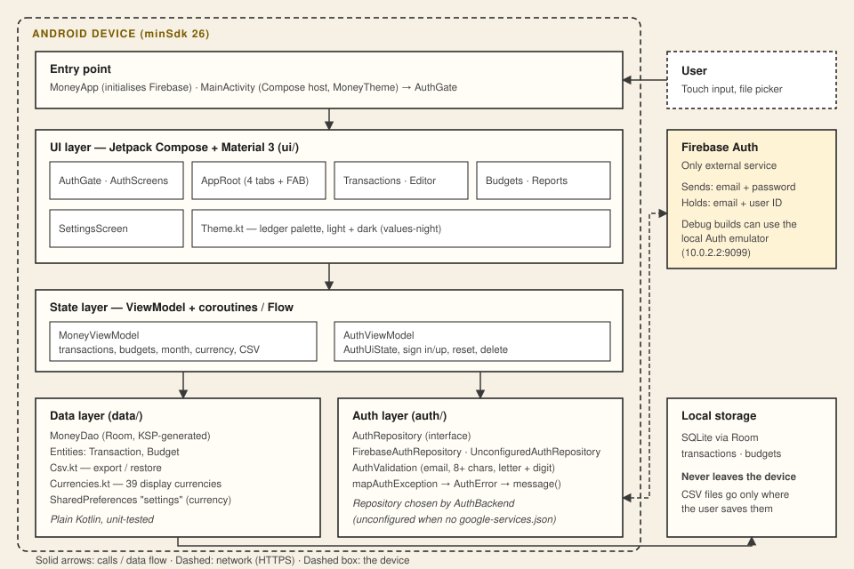
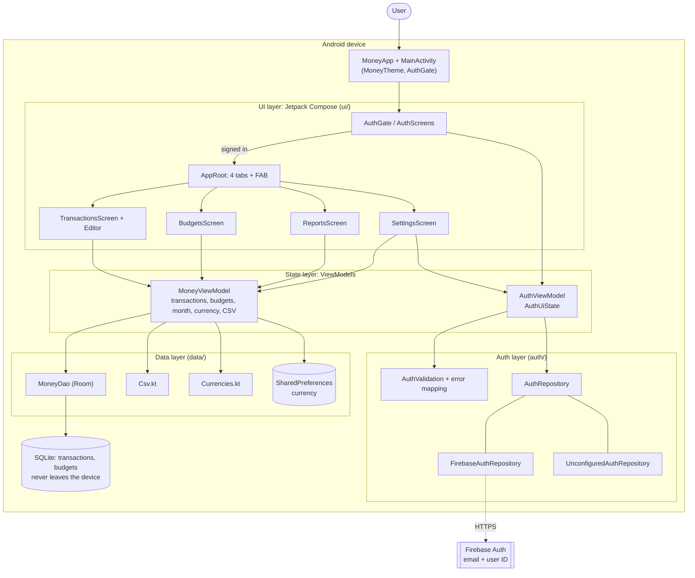
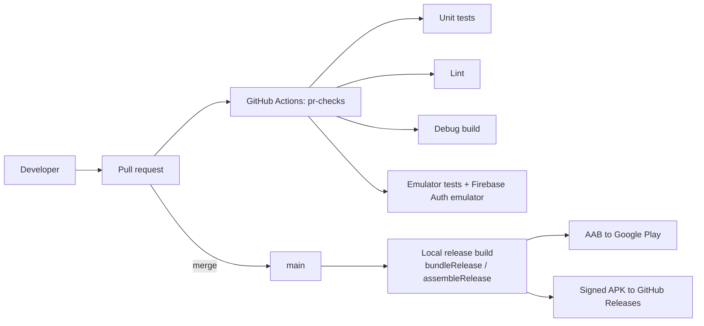

# MoneyTrack: Architecture

MoneyTrack is a single-module Android app using **MVVM**. The UI is Jetpack Compose, state is exposed from `ViewModel`s as Kotlin `Flow`/`StateFlow`, and data is stored locally in Room. Firebase Auth is the only external service.



The same diagram as Mermaid (renders on GitHub):



## Layers

| Layer | Package / files | Responsibility |
|---|---|---|
| Entry | `MoneyApp.kt`, `MainActivity.kt` | Initialises Firebase (if configured), hosts Compose, wraps content in `AuthGate`. |
| UI | `ui/` | Stateless-ish composables. `AppRoot` owns tab selection and the editor dialog; screens receive data and callbacks. |
| State | `MoneyViewModel.kt`, `auth/AuthViewModel.kt` | Expose `StateFlow`s (`WhileSubscribed(5_000)`), launch coroutines for writes. |
| Data | `data/` | `Database.kt` (entities, DAO, `AppDatabase`), `Csv.kt` (export/parse), `Currencies.kt` (39 currencies). |
| Auth | `auth/` | `AuthRepository` interface with Firebase and "unconfigured" implementations, validation and error mapping that do not depend on Firebase types. |

## Key design decisions

- **Auth gate.** `MainActivity` renders `AuthGate(auth) { AppRoot(vm, auth) }`. The main app only composes once the user is signed in.
- **Swappable auth backend.** `AuthBackend.create` returns `FirebaseAuthRepository` when Firebase is configured, otherwise `UnconfiguredAuthRepository`, whose calls return `AuthError.NotConfigured`. Debug builds run without any Firebase config.
- **Auth logic is plain Kotlin.** `AuthValidation`, `AuthError` and `mapAuthException` are unit-testable without Android.
- **Reactive reads.** The DAO returns `Flow<List<...>>`; the ViewModel turns them into `StateFlow`s and the UI collects them with `collectAsStateWithLifecycle`.
- **Money as cents.** Amounts are `Long` cents; formatting uses the selected currency (display only, no conversion).
- **Atomic restore.** `MoneyDao.replaceAll` clears and re-inserts transactions in one DAO operation.
- **Local-only data.** No network code touches transactions or budgets. This is a product invariant (see [PRIVACY.md](../PRIVACY.md)).

## Build and delivery



Release builds need `app/google-services.json` and signing config (`keystore.properties`); both are git-ignored and never held by CI.

## Repository map

```
app/src/main/java/com/moneytrack/app/   application code (see layers above)
app/src/test/                           JUnit 4 unit tests
app/src/androidTest/                    Room DAO and Firebase Auth emulator tests
app/src/debug/                          debug manifest + network config for the emulator
site/                                   static website (landing, privacy, account deletion)
store/                                  Play assets and Data safety answers
docs/                                   this documentation
.github/workflows/pr-checks.yml         CI
```
