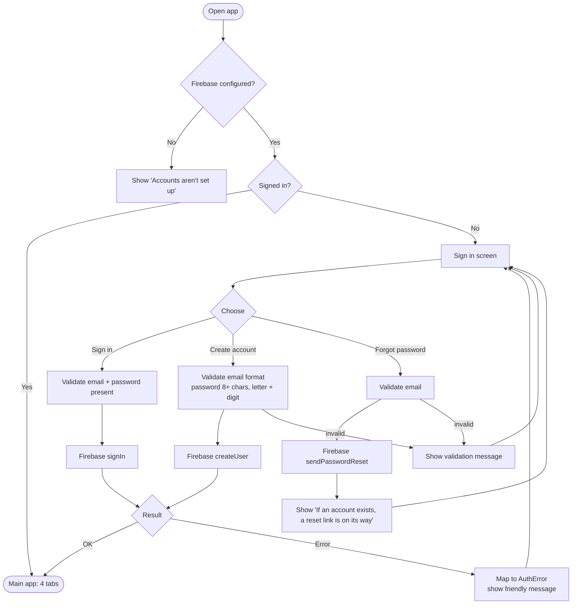
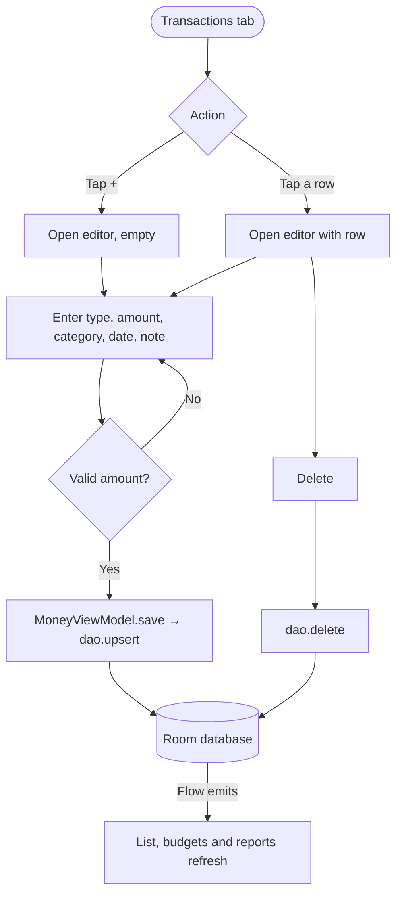
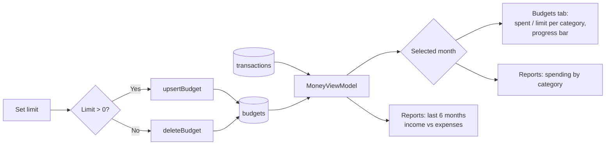
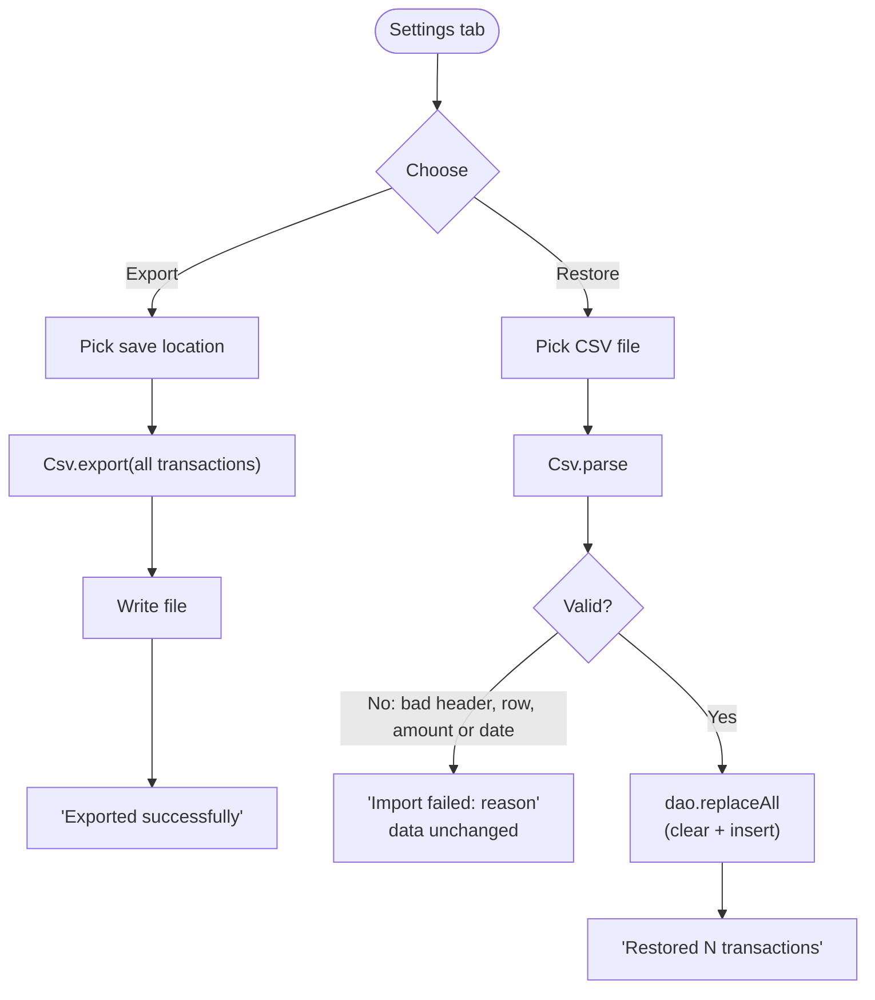
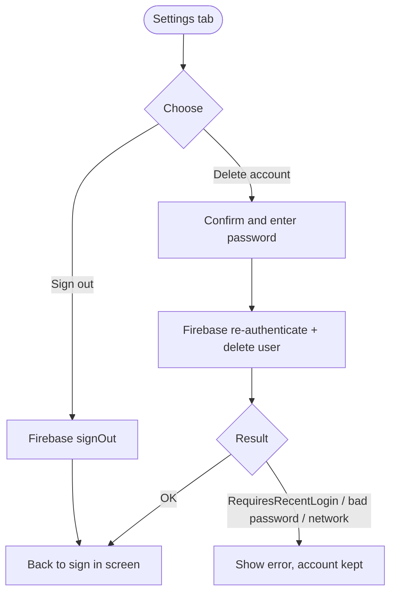
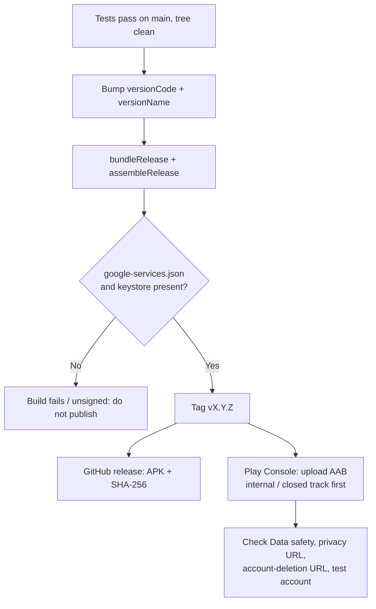

# MoneyTrack: Flow Charts

All charts are Mermaid and render on GitHub.

## 1. App launch and authentication

## 2. Add or edit a transaction

## 3. Budgets and reports

## 4. CSV backup and restore

## 5. Sign out and delete account

## 6. Release flow

